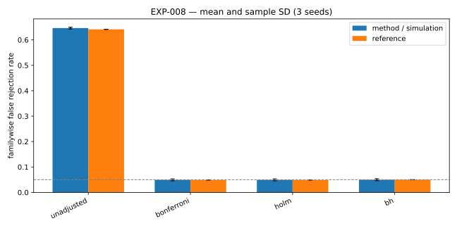

# Statistics for AI — AIR-003

**Status:** educational implementation audited locally; updated hosted CI and release review pending.

Learn statistical evaluation through transparent Python methods, controlled Monte Carlo simulations, and executable notebooks. Complements [AIR-001](https://github.com/MarkRizam/machine-learning-from-scratch), [AIR-002](https://github.com/MarkRizam/mathematics-for-ai) and [RizamLearning](https://github.com/MarkRizam/RizamLearning).

## Implemented
15 public statistical functions: descriptive statistics, covariance, normal CDF, Bayes rule, Student-t mean interval, one-sample z/t and paired t tests, paired standardized effect, chi-square goodness-of-fit, percentile bootstrap, paired sign-flip randomization, t power, minimum sample size and p-value adjustments (Holm, Bonferroni, BH). SciPy supplies distribution tails and quantiles; not a from-scratch special-function library.

## Reproduce
Use a Python virtual environment (Python 3.13 tested). For PowerShell set `$env:OPENBLAS_NUM_THREADS='1'` and `$env:OMP_NUM_THREADS='1'`; Bash: `export OPENBLAS_NUM_THREADS=1 OMP_NUM_THREADS=1`.

```sh
python -m pip install -e ".[research]"
python -m pytest -q
python scripts/verify_committed_results.py
python -m stats_for_ai.experiments
python scripts/notebooks.py
```

## Results
Eight experiments, 27 configurations, 81 per-seed records, eight executed notebooks and 44 local passing tests. Full evidence: [research report](research/report.md), [protocol](research/protocol.md), [benchmark data](results/benchmarks.json), [limitations](research/limitations.md).



Among 20 independent null tests, the simulated probability of at least one false rejection was 64.65% unadjusted and approximately 5% after adjustment. This is a synthetic global-null experiment, not a claim that BH generally controls FWER. All results report three-seed descriptive variability.

## V1.1 audit

15 new regression cases; 59 local tests passed. All 81 committed records reproduced within absolute tolerance 1e-10 (maximum observed baseline difference 6.66e-16). See [scientific audit](research/audit-v1.1.md) for corrections, statistical assumptions and limits.

## Contributions and license
MIT for original code; dependencies retain their licenses. See [LICENSE](LICENSE), [CONTRIBUTING.md](CONTRIBUTING.md) and [CITATION.cff](CITATION.cff). No sensitive or external datasets; no paid APIs. Not peer-reviewed research.
